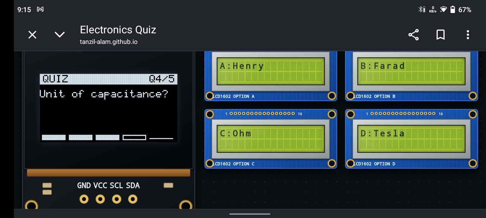

# Elecquiz

I made a electronics themed web quiz game!! With html css and js, i used oled and 16*2 display as a question/option display

## What is it

Elecquiz is a single html file web game, that runs on your browser, with all type of device display ratio. it has electrical component themed web interface, with oled display as a main display and 16*2 display as option

## Quick start guide

I made it single file, so it's pretty easy to run.

1. clone the repo: `git clone https://github.com/Tanzil-Alam/Elecquiz.git`
2. go into the folder and open `index.html`
3. for control, you can use touch, 1234, abcd. that's it.

## Why i made it

just to see how much i can push with html css and js, that's what I did and I am very satisfied with it.

## How it works

it runs on a single file with html, css and javascript, the oled has a custom fonts for it, the lcd has it's own. everything is designed by me, for question logic, it has a block with question, i can add or remove as many questions. it will always give 5 random question out.
